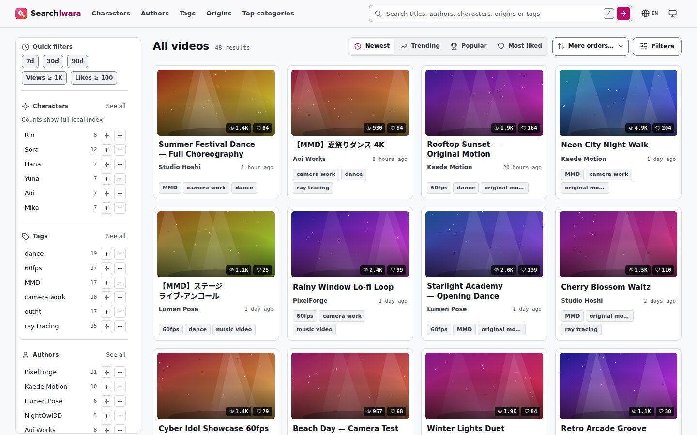
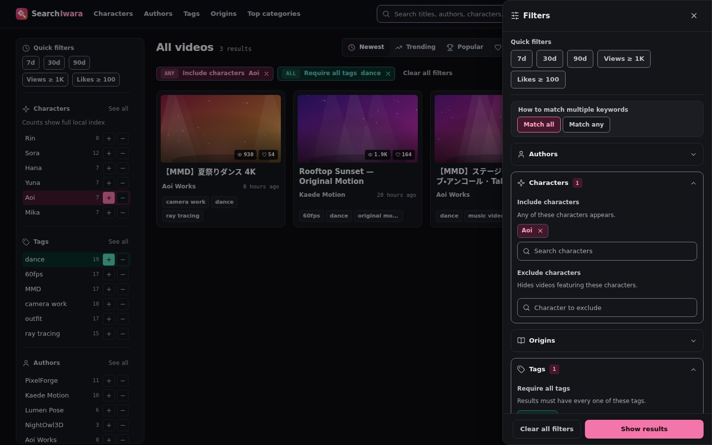
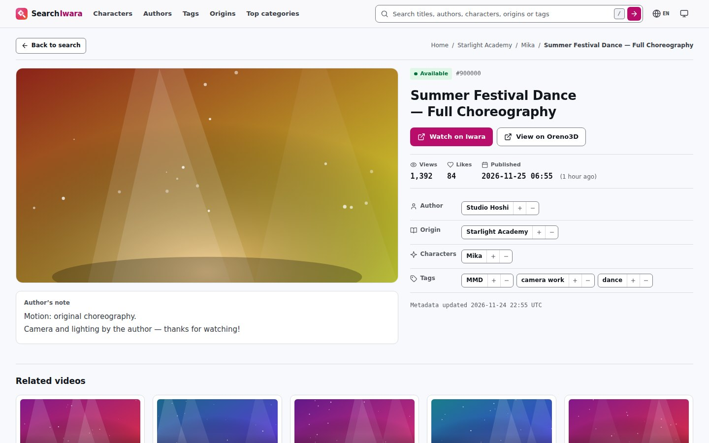
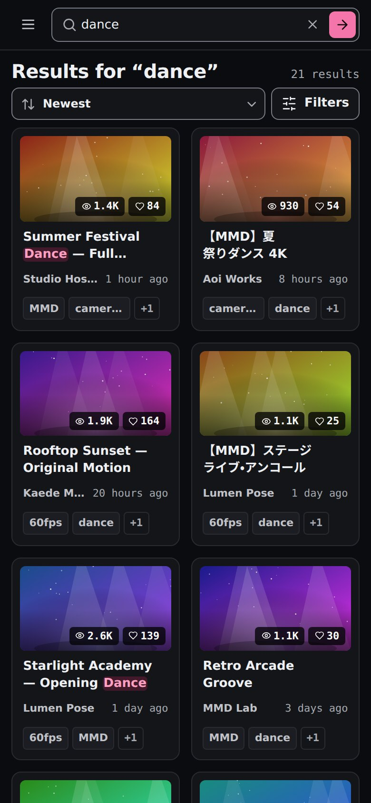
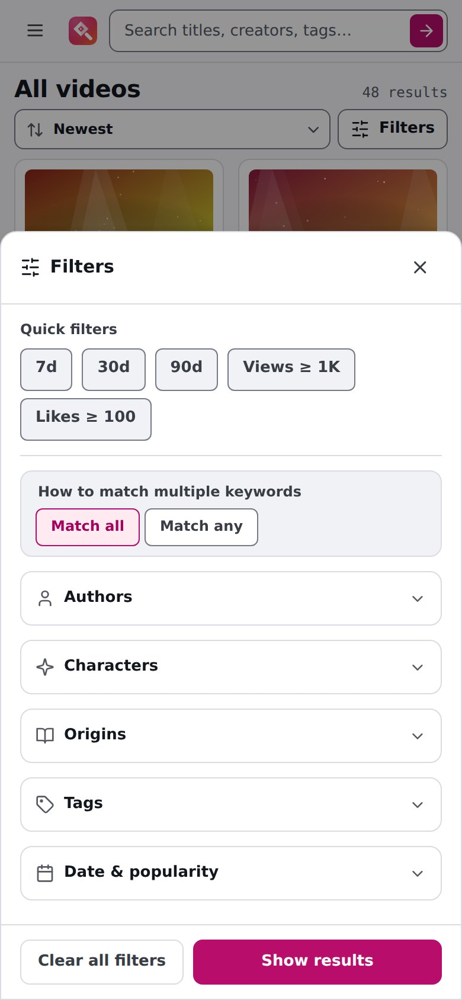
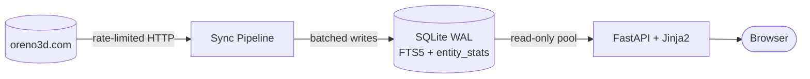

<div align="center">


# Search Iwara

Self-hosted metadata index and boolean search interface for [Oreno3D](https://oreno3d.com/), backed by a single SQLite file.

[](https://github.com/beautifulrem/iwara-search/actions/workflows/ci.yml)
[](https://github.com/beautifulrem/iwara-search/releases)
[](https://github.com/beautifulrem/iwara-search/pkgs/container/iwara-search)
[](pyproject.toml)
[](LICENSE)

[**Live Demo (NSFW)**](https://zundamon.dpdns.org/) ·
[Quick Start](#quick-start) ·
[Deployment](docs/linux-deploy.md) ·
[Configuration](docs/configuration.md) ·
[Architecture](docs/architecture.md) ·
[Benchmarks](docs/benchmarks.md) ·
[简体中文](README.zh-CN.md) ·
[LINUX DO](https://linux.do/)

</div>

> [!WARNING]
> Upstream Oreno3D metadata and the public demo index **adult content**. Do not open them in workplaces or public spaces.
> Search Iwara downloads and hosts **no video files**; it indexes publicly listed metadata and links out to the original pages.

<picture>
  <source media="(prefers-color-scheme: dark)" srcset="docs/assets/screenshots/home-dark.jpg">
  
</picture>
<p align="center"><sub>Screenshots render synthetic, work-safe demo entries generated by <a href="scripts/make_screenshots.py"><code>scripts/make_screenshots.py</code></a>.</sub></p>

## Why Search Iwara

Browsing Oreno3D directly works well for recent uploads or a single tag page, but falls short once you want to intersect multiple tags, exclude specific creators or franchises, bound results by views or publish date, search CJK substrings reliably, or look up metadata after an upstream video has been taken down.

Search Iwara syncs public listing and detail pages into a local SQLite database (WAL + compact `contentless_delete` FTS5) and serves a fast, keyboard-friendly web UI on top of it:

- **Full-text search across Latin and CJK scripts**: one query box searches titles, authors, characters, origins, and tags using dual FTS5 indexes (`trigram` for 3+ character substrings and `unicode61` n-grams for 1–2 character CJK queries).
- **Boolean facets with live counts**: combine `ALL` / `ANY` / `NOT` tag rules, include or exclude authors, characters, and origins, and bound publish dates, views, or likes. Sidebar facet counts update to reflect the active result set, and one-click `+` (include) / `−` (exclude) buttons refine queries without resetting state.
- **Searchable directories and archival records**: eight sort orders, searchable and multi-sortable directories for characters, authors, tags, origins, and categories, weighted related works, preserved `missing` records when upstream videos disappear, and persistent operator takedowns (`db suppress`).
- **Progressive enhancement and accessibility**: server-rendered FastAPI + Jinja2 pages that remain usable with JavaScript disabled (including server-side entity name resolution), WAI-ARIA 1.2 comboboxes, `zh-Hans` / `ja` / `en` locales, light/dark themes, and `axe-core` WCAG 2.2 AA checks across Chromium, Firefox, and WebKit.
- **Bounded, resumable crawler**: validates every redirect hop (up to 5 hops) against `robots.txt` (RFC 9309) and the `https` origin allow-list, caps response sizes, throttles automatically on `429`/`503` while honouring `Retry-After`, supports HTTP/SOCKS5 proxies, resumes interrupted full crawls, and aborts cleanly (exit code `2`) if upstream HTML changes.
- **Zero external services**: no Redis, Elasticsearch, or message broker. Ships with online compressed SQLite backups, disk-headroom guards, JSON logs, `/healthz` + `/readyz` + `/metrics`, Prometheus alert rules, hardened `systemd` + `nginx` tooling, and multi-arch (`linux/amd64`, `linux/arm64`) container images.

<table>
  <tr>
    <td width="50%"></td>
    <td width="50%"></td>
  </tr>
  <tr>
    <td align="center"><sub>Boolean filter drawer and active query chips</sub></td>
    <td align="center"><sub>Detail page with one-click taxonomy filters and related works</sub></td>
  </tr>
</table>

<p align="center">
  
  &nbsp;&nbsp;
  
</p>

## Quick Start

### Docker Compose (prebuilt `amd64` / `arm64` image)

No source checkout is needed. This starts the web UI on `http://127.0.0.1:8000`, runs an initial `sync latest` immediately (then every 6 hours), and rotates daily SQLite backups in a named volume:

```bash
mkdir search-iwara && cd search-iwara
curl -fsSLO https://raw.githubusercontent.com/beautifulrem/iwara-search/main/compose.yaml
docker compose up -d
```

To crawl the entire historical catalogue (resumable across restarts; takes several hours at default rate limits):

```bash
docker compose exec sync search-iwara sync full
```

### From Source

Requires Python 3.13+ and [uv](https://docs.astral.sh/uv/).

```bash
git clone https://github.com/beautifulrem/iwara-search.git
cd iwara-search
uv sync
uv run search-iwara sync latest --max-pages 3   # fetch ~3 pages of recent entries (~1 min)
uv run search-iwara serve                       # listen on http://127.0.0.1:8000
```

### Linux Server (`systemd` + `nginx`)

```bash
sudo git clone https://github.com/beautifulrem/iwara-search.git /opt/search-iwara
sudo /opt/search-iwara/deploy/linux/install.sh --server-name search.example.com --sync-hours 6
```

Or run `sudo /opt/search-iwara/deploy/linux/manage.py` for interactive setup, TLS configuration, manual syncs, backups, and upgrades. See [docs/linux-deploy.md](docs/linux-deploy.md).

> [!NOTE]
> **Crawler etiquette:** Default limits (`4` concurrent workers, `2.0` requests/s ceiling, `robots.txt` enabled, automatic rate halving on `429`/`503`) are intentionally conservative. Please keep them gentle and respect the upstream site's terms of use.

## Usage

### CLI Commands

| Command | Description |
|---|---|
| `search-iwara sync latest [--stable-pages N] [--max-pages N]` | Incremental sync; stops after `N` consecutive pages with no unseen movie IDs (default `3`) |
| `search-iwara sync full [--start-page N] [--max-pages N]` | Resumable crawl of the full catalogue |
| `search-iwara db migrate` | Create or upgrade the SQLite schema up to v5 (idempotent) |
| `search-iwara db backup [--dest DIR] [--keep N] [--compress]` | Online SQLite backup (`PRAGMA quick_check` + disk-headroom guard + rotation) |
| `search-iwara db refresh` | Recompute `entity_stats` rankings, JST trending scores, and FTS segment merges |
| `search-iwara db reindex [--verify]` | Stream-rebuild FTS5 indexes in 5,000-row batches, or `--verify` active-row parity |
| `search-iwara db suppress <id...> [--reason TEXT]` | Hide movie IDs across search, rankings, APIs, and sitemaps (persists across syncs) |
| `search-iwara db unsuppress <id...>` | Restore suppressed movie IDs back into search and rankings |
| `search-iwara serve [--host] [--port] [--reload]` | Start the FastAPI web server |

Sync exit codes: `0` success, `1` failed pages/details above tolerance or unreachable `robots.txt`, `2` upstream HTML parser drift, `75` another sync holds the lock, `78` invalid configuration, `143` stopped cleanly on `SIGTERM`/`SIGINT` (committed progress preserved).

<details>
<summary><b>URL Query Parameters & Examples</b></summary>

Every search state maps directly to URL query parameters on `/`. Entity directory pages (`/characters`, `/authors`, `/tags`, `/origins`, `/categories`) also accept `?q=<name>` and `?sort=hot|popularity|count|favorites|views`.

| Category | Parameters |
|---|---|
| Keyword | `q` (matches title, author, character, origin, and tag names; up to 200 chars), `title_mode=all\|any` |
| Entities | `author_any`, `author_not`, `character_any`, `character_not`, `origin_any`, `origin_not` |
| Tags | `tag_all` (every tag required), `tag_any` (any tag matches), `tag_not` (exclude tags) |
| Ranges | `published_from`, `published_to` (`YYYY-MM-DD`), `min_views`, `max_views`, `min_favorites`, `max_favorites` |
| Sort & Paging | `sort=hot\|popularity\|favorites\|latest\|views` (or `*_desc` / `*_asc`), `page`, `lang=zh-Hans\|ja\|en` |

Entity parameters accept comma-separated upstream IDs (up to 20 per parameter):

```text
/?q=Yelan                                       match "Yelan" across title and entity names
/?author_any=4972&sort=hot                      single creator, sorted by trending score
/?origin_any=276&character_any=1470             specific franchise + character
/?tag_all=302,303&tag_not=84                    require both tags 302 and 303, exclude tag 84
/?min_views=1000&min_favorites=100&sort=popularity
/authors?q=studio&sort=popularity               filter and sort the authors directory
```

</details>

<details>
<summary><b>Ranking & Related-Video Formulas</b></summary>

All scores are computed from your locally indexed dataset:

| Sort | Formula |
|---|---|
| Most liked | `favorite_count DESC` |
| Newest | `published_at DESC` |
| Popular | `view_count + favorite_count * 50` |
| Trending | `popularity / (hours_since_publish_jst + 6)`, refreshed after each sync |

**Related videos** (up to 12 per detail page): same author `+10`, each shared character or origin `+5`, each shared tag `+1`, with ties broken by `popularity`. Entities attached to more than 5% of the local corpus are skipped so ubiquitous tags (`MMD`, `dance`) do not dominate recommendations.

</details>

## Architecture & Documentation



`search-iwara sync` fetches listing pages, queues new or stale detail pages through a bounded worker pool, validates every URL and redirect hop against a strict `https` host allow-list, and commits writes in 25-movie batches. `search-iwara serve` opens a pool of `PRAGMA query_only` SQLite connections (one per worker thread) and serves server-rendered HTML with weak `ETag` caching and strict `Content-Security-Policy` headers.

| Document | Contents |
|---|---|
| [docs/linux-deploy.md](docs/linux-deploy.md) | Docker Compose, `systemd` + `nginx` installer, `manage.py`, TLS, backups, Prometheus rules |
| [docs/configuration.md](docs/configuration.md) | All `SEARCH_IWARA_*` environment variables, CLI flags, maintenance commands, and exit codes |
| [docs/architecture.md](docs/architecture.md) | Module boundaries, Schema v5 data model, dual FTS5 indexing, sync checkpoints, and web security |
| [docs/benchmarks.md](docs/benchmarks.md) | 200,000-movie storage footprint, query latencies, and multi-thread concurrency profile |
| [docs/design.md](docs/design.md) | UI layout structure, OKLCH design tokens, facet workflows, and frontend conventions |
| [docs/accessibility.md](docs/accessibility.md) | Automated WCAG 2.2 AA test coverage, manual screen-reader checklist, and known limits |
| [docs/troubleshooting.md](docs/troubleshooting.md) | Operational, proxy, SQLite locking, takedown suppression, and exit-code diagnostics |

## Development

```bash
uv sync && uv run pre-commit install
make check   # ruff, mypy --strict, tsc --checkJs, unit/property tests (>= 95% coverage)
make perf    # query and refresh latency budgets against a synthetic 200k-movie database
make e2e     # Playwright end-to-end + axe-core WCAG 2.2 AA suite
make serve   # local dev server with auto-reload on http://127.0.0.1:8765
```

<details>
<summary><b>Project Layout</b></summary>

```text
search_iwara/
  cli.py               Typer CLI (sync, db, serve) and exit-code mapping
  config.py            Pydantic settings read from SEARCH_IWARA_* env vars
  crawler.py           HTTP/2 client: robots.txt, validated redirects, AIMD limiter, retries
  parsers.py           selectolax (Lexbor) HTML parsers, URL allow-list, drift detection
  services.py          Sync orchestration: listing scan, detail queue, lock & checkpoints
  storage/             Schema v5 migrations, write store, FTS5 indexers, search & ranking stores
  web/                 FastAPI app factory, HTML/JSON routes, ops endpoints, CSP & metrics
  templates/, static/  Jinja2 templates, CSS layers, type-checked ES modules, SVG sprite
  i18n.py, locales/    Locale negotiation and catalogs (zh-Hans, ja, en)
deploy/                systemd units, nginx templates, manage.py, Docker loops, Prometheus rules
scripts/               Release helper, 200k benchmark harness, icon & demo screenshot generators
tests/                 Unit, Hypothesis property, deploy, 200k-row perf, and Playwright E2E suites
```

</details>

## Contributing & Security

Bug reports and pull requests are welcome; see [CONTRIBUTING.md](CONTRIBUTING.md) for local checks and release steps. Please report security issues privately via [SECURITY.md](SECURITY.md). Release history is tracked in [CHANGELOG.md](CHANGELOG.md).

## Acknowledgements & Disclaimer

All indexed metadata and thumbnails remain the property of their respective creators on [Oreno3D](https://oreno3d.com/) and [Iwara](https://www.iwara.tv/). This project is independent and is neither affiliated with nor endorsed by Oreno3D or Iwara.

## License

[MIT](LICENSE)
