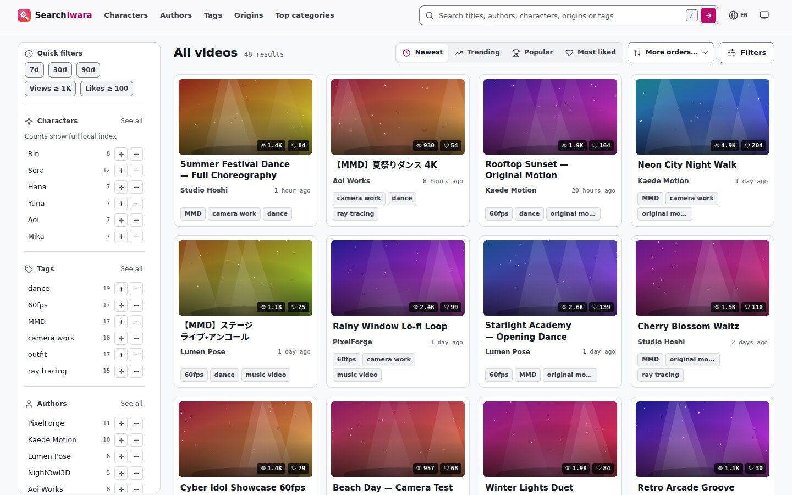
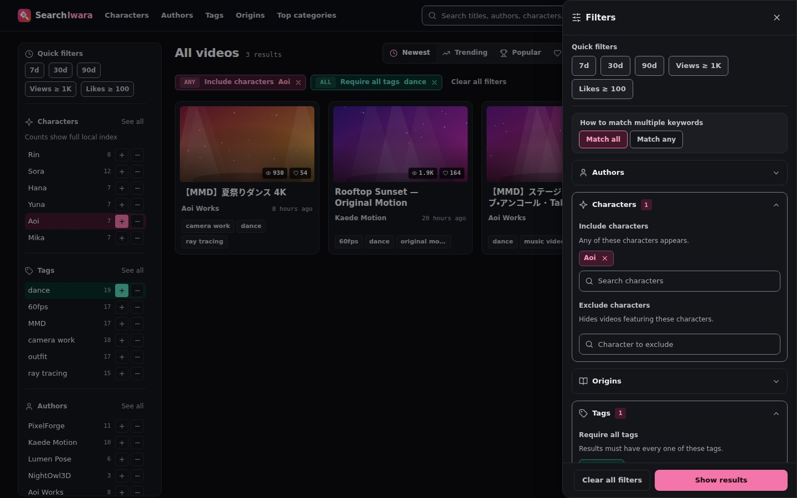
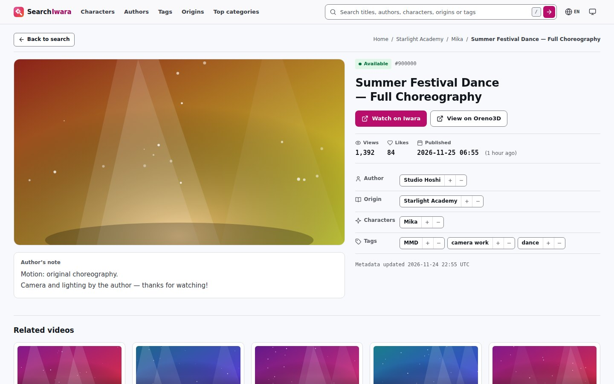
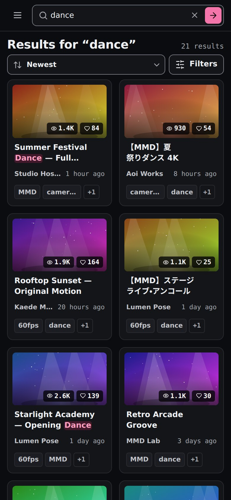
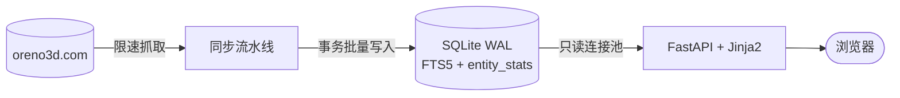

<div align="center">


# Search Iwara

基于单文件 SQLite 的 [Oreno3D](https://oreno3d.com/) 元数据自托管索引与多维检索前端。

[](https://github.com/beautifulrem/iwara-search/actions/workflows/ci.yml)
[](https://github.com/beautifulrem/iwara-search/releases)
[](https://github.com/beautifulrem/iwara-search/pkgs/container/iwara-search)
[](pyproject.toml)
[](LICENSE)

[**在线演示（NSFW）**](https://zundamon.dpdns.org/) ·
[快速上手](#快速上手) ·
[部署指南](docs/linux-deploy.md) ·
[配置说明](docs/configuration.md) ·
[系统架构](docs/architecture.md) ·
[性能基准](docs/benchmarks.md) ·
[English](README.md) ·
[LINUX DO](https://linux.do/)

</div>

> [!WARNING]
> 源站元数据及在线演示站均包含**成人内容**，请勿在工作场所或公共场合打开。
> 本项目**不下载、不缓存、不托管任何视频文件**，仅同步公开页面的元数据并提供外链跳转。

<picture>
  <source media="(prefers-color-scheme: dark)" srcset="docs/assets/screenshots/home-dark.jpg">
  
</picture>
<p align="center"><sub>文档截图均使用 <a href="scripts/make_screenshots.py"><code>scripts/make_screenshots.py</code></a> 生成的脱敏演示数据渲染。</sub></p>

## 项目简介

原站 Oreno3D 适合浏览最新投稿或单个标签页，但在深度检索场景下存在明显局限：无法同时要求多个标签、无法排除特定作者或标签、不支持按播放量/点赞数/日期区间过滤、中日文子串检索受限，且原站稿件下架后历史元数据随之不可查。

Search Iwara 将公开列表页与详情页同步到本地单个 SQLite 数据库（WAL + 紧凑型 `contentless_delete` FTS5），在此之上提供毫秒级响应的 Web 检索界面：

- **中日英混合全文检索**：单个搜索框同时覆盖标题、作者、角色、原作与标签；底层采用双 FTS5 表（3 字符以上走 `trigram` 子串索引，1–2 个中日文字符走 `unicode61` 词元索引），不退化为全表扫描。
- **动态分面与布尔组合**：支持标签必含（`ALL`）/ 任一（`ANY`）/ 排除（`NOT`），支持作者、角色、原作的包含与排除，以及日期、播放量、点赞数区间过滤；左侧分面计数随当前检索结果实时联动，且支持一键 `+`（加入条件）与 `−`（排除条件）。
- **可检索目录与归档保留**：内置 8 种排序、支持按名称搜索与多维排序的 5 类实体目录（角色、作者、标签、原作、分类）、抑制高频泛用词的相关推荐、原站删稿后的归档状态保留（`missing`），以及跨同步持久生效的本地屏蔽机制（`db suppress`）。
- **渐进增强与无障碍支持**：服务端直出 HTML（FastAPI + Jinja2），禁用 JavaScript 时仍可正常检索与按名称匹配实体；支持 `zh-Hans` / `ja` / `en` 三语切换、浅色/深色主题、键盘导航，并通过 Chromium、Firefox、WebKit 三端 `axe-core` WCAG 2.2 AA 自动化校验。
- **受控、可续传的同步器**：逐跳校验最多 5 次重定向的 `robots.txt`（RFC 9309）与 `https` 域名白名单，流式限制响应体体积，遇到 `429`/`503` 自动降速并遵守 `Retry-After`，支持 HTTP / SOCKS5 代理；全量抓取支持断点续传，源站改版时以退出码 `2` 安全停机。
- **轻量单机运维**：无需额外部署 Redis 或外部搜索引擎；内置支持压缩的 SQLite 在线热备、磁盘余量保护、JSON 日志、`/healthz` + `/readyz` + `/metrics` 探针、Prometheus 告警规则、`systemd` + `nginx` 部署脚本，以及预构建的 `linux/amd64`、`linux/arm64` 多架构容器镜像。

<table>
  <tr>
    <td width="50%"></td>
    <td width="50%"></td>
  </tr>
  <tr>
    <td align="center"><sub>布尔筛选抽屉与已生效条件标签</sub></td>
    <td align="center"><sub>详情页元数据、实体一键筛选与相关推荐</sub></td>
  </tr>
</table>

<p align="center">
  
  &nbsp;&nbsp;
  
</p>

## 快速上手

### 方式一：Docker Compose（推荐，预构建 `amd64` / `arm64` 镜像）

无需克隆源码，下载 `compose.yaml` 即可启动 Web 服务（默认监听 `http://127.0.0.1:8000`）、启动即执行的 6 小时周期增量同步与每日自动备份：

```bash
mkdir search-iwara && cd search-iwara
curl -fsSLO https://raw.githubusercontent.com/beautifulrem/iwara-search/main/compose.yaml
docker compose up -d
```

如需建立完整历史索引库（支持中断后续传，在默认温和限速下耗时数小时）：

```bash
docker compose exec sync search-iwara sync full
```

### 方式二：源码运行

需要 Python 3.13+ 与 [uv](https://docs.astral.sh/uv/)：

```bash
git clone https://github.com/beautifulrem/iwara-search.git
cd iwara-search
uv sync
uv run search-iwara sync latest --max-pages 3   # 抓取最近 3 页索引（约 1 分钟）
uv run search-iwara serve                       # 访问 http://127.0.0.1:8000
```

### 方式三：Linux 服务器部署（`systemd` + `nginx`）

```bash
sudo git clone https://github.com/beautifulrem/iwara-search.git /opt/search-iwara
sudo /opt/search-iwara/deploy/linux/install.sh --server-name search.example.com --sync-hours 6
```

也可直接运行交互式管理工具 `sudo /opt/search-iwara/deploy/linux/manage.py` 配置域名、HTTPS 证书、代理、定时任务与一键升级。详见 [docs/linux-deploy.md](docs/linux-deploy.md)。

> [!NOTE]
> **抓取礼仪：** 默认参数（最多 `4` 并发、上限 `2.0` 请求/秒、启用 `robots.txt`、遇到 `429`/`503` 自动减半限速）有意保持温和，请勿盲目调高并发，共同维护源站可用性。

## 命令行与查询语法

### CLI 子命令

| 命令 | 说明 |
|---|---|
| `search-iwara sync latest [--stable-pages N] [--max-pages N]` | 增量同步：连续 `N` 页未出现新作品 ID 即停止（默认 `3`） |
| `search-iwara sync full [--start-page N] [--max-pages N]` | 全量抓取，自动记录检查点并支持断点续传 |
| `search-iwara db migrate` | 初始化或升级 SQLite 表结构至 v5（幂等） |
| `search-iwara db backup [--dest DIR] [--keep N] [--compress]` | 在线一致性备份（含 `PRAGMA quick_check` 校验、磁盘余量检查与轮转） |
| `search-iwara db refresh` | 重新计算实体榜单、JST 飙升热度分并整理 FTS 分段 |
| `search-iwara db reindex [--verify]` | 按 5,000 行批次流式重建 FTS5 搜索索引，或 `--verify` 校验索引一致性 |
| `search-iwara db suppress <id...> [--reason TEXT]` | 在搜索、榜单、API 与 Sitemap 中屏蔽指定作品 ID（跨同步持久生效） |
| `search-iwara db unsuppress <id...>` | 解除作品屏蔽并恢复索引与榜单统计 |
| `search-iwara serve [--host] [--port] [--reload]` | 启动 FastAPI Web 服务 |

同步退出码：`0` 正常完成；`1` 列表失败、详情失败数超出容忍阈值或 `robots.txt` 不可达；`2` 源站页面结构变更（触发解析保护）；`75` 已有同步进程持有文件锁；`78` 配置参数非法；`143` 收到 `SIGTERM`/`SIGINT` 安全退出（已提交进度完整保留）。

<details>
<summary><b>URL 查询参数与检索示例</b></summary>

所有搜索状态均编码在 `/` 的查询参数中；实体目录页（`/characters`、`/authors`、`/tags`、`/origins`、`/categories`）同样支持 `?q=<名称>` 与 `?sort=hot|popularity|count|favorites|views`。

| 维度 | 参数 |
|---|---|
| 文本搜索 | `q`（匹配标题、作者、角色、原作、标签名，最长 200 字符）、`title_mode=all\|any` |
| 作者 / 角色 / 原作 | `author_any`、`author_not`、`character_any`、`character_not`、`origin_any`、`origin_not` |
| 标签布尔逻辑 | `tag_all`（必须同时包含）、`tag_any`（命中任一）、`tag_not`（排除指定标签） |
| 区间范围 | `published_from`、`published_to`（`YYYY-MM-DD`）、`min_views`、`max_views`、`min_favorites`、`max_favorites` |
| 排序与分页 | `sort=hot\|popularity\|favorites\|latest\|views`（及 `*_desc` / `*_asc`）、`page`、`lang=zh-Hans\|ja\|en` |

实体参数使用逗号分隔的源站数字 ID（单参数最多 20 个）：

```text
/?q=Yelan                                       标题或任意关联名称包含 "Yelan"
/?author_any=4972&sort=hot                      指定作者，按近期飙升排序
/?origin_any=276&character_any=1470             限定指定原作与角色
/?tag_all=302,303&tag_not=84                    同时包含标签 302 与 303，且排除标签 84
/?min_views=1000&min_favorites=100&sort=popularity
/authors?q=studio&sort=popularity               搜索并按热门分排序作者目录
```

</details>

<details>
<summary><b>排序评分与相关推荐公式</b></summary>

所有排行均依据**本地已同步数据集**计算：

| 排序 | 计算方式 |
|---|---|
| 高赞 (`favorites`) | `favorite_count DESC` |
| 最新 (`latest`) | `published_at DESC` |
| 热门 (`popularity`) | `view_count + favorite_count * 50` |
| 飙升 (`hot`) | `popularity / (距 JST 发布时间小时数 + 6)`，每次同步结束后刷新 |

**相关作品**（每页最多 12 条）：同作者 `+10`、每个共同角色或原作 `+5`、每个共同标签 `+1`，同分按热门分排序；覆盖全库超过 5% 作品的高频泛用实体自动忽略，避免泛化标签稀释推荐准确度。

</details>

## 架构概览与文档索引



同步进程扫描列表页、通过有界工作池抓取详情、校验每一跳重定向与 `https` 域名白名单，并按 25 条一批提交写入；Web 进程在启动时完成幂等迁移后，为每个工作线程维护独立的 `PRAGMA query_only` 只读连接，配合弱 `ETag` 协商缓存与严格 `Content-Security-Policy` 响应头提供低延迟读取。

| 文档 | 内容说明 |
|---|---|
| [docs/linux-deploy.md](docs/linux-deploy.md) | Docker Compose、`systemd` + `nginx` 部署脚本、`manage.py`、TLS、备份恢复与监控告警 |
| [docs/configuration.md](docs/configuration.md) | 全部 `SEARCH_IWARA_*` 环境变量、数据库维护命令与退出码对照表 |
| [docs/architecture.md](docs/architecture.md) | 模块边界、Schema v5 数据模型、双 FTS5 索引、断点续传算法与 Web 安全设计 |
| [docs/benchmarks.md](docs/benchmarks.md) | 20 万条作品规模下的存储占用、查询延迟与并发吞吐实测数据 |
| [docs/design.md](docs/design.md) | 前端布局架构、OKLCH 色彩令牌、分面交互约定与前端工程约束 |
| [docs/accessibility.md](docs/accessibility.md) | WCAG 2.2 AA 自动化检查覆盖范围、读屏器回归清单与已知限制 |
| [docs/troubleshooting.md](docs/troubleshooting.md) | 代理连接、SQLite 锁冲突、下架屏蔽、索引校验与常见退出码排查手册 |

## 本地开发

```bash
uv sync && uv run pre-commit install
make check   # 代码格式、ruff、mypy --strict、tsc --checkJs 及单测覆盖率门槛（>= 95%）
make perf    # 20 万条合成作品库上的查询与派生表刷新延迟基准
make e2e     # Playwright 浏览器端到端与 axe-core 无障碍测试
make serve   # 启动带自动重载的本地开发服务（http://127.0.0.1:8765）
```

<details>
<summary><b>目录结构</b></summary>

```text
search_iwara/
  cli.py               Typer 命令行入口（sync / db / serve）与退出码映射
  config.py            基于 pydantic-settings 的 SEARCH_IWARA_* 配置校验
  crawler.py           HTTP/2 客户端：robots.txt、重定向校验、AIMD 动态限速、重试
  parsers.py           selectolax (Lexbor) 页面解析、URL 白名单与改版漂移检测
  services.py          同步编排：列表扫描、有界详情队列、文件锁与续传检查点
  storage/             Schema v5 迁移、写入模型、双 FTS5 索引维护、检索与榜单只读查询
  web/                 FastAPI 应用工厂、页面与补全接口、运维探针、CSP 与指标中间件
  templates/, static/  Jinja2 模板、分层原生 CSS、带类型检查的 ES 模块、SVG 图标精灵
  i18n.py, locales/    多语言协商与翻译词表（zh-Hans、ja、en）
deploy/                systemd 单元、nginx 模板、manage.py、Docker 循环脚本、Prometheus 规则
scripts/               发版辅助脚本、20 万级基准测试、品牌图标与脱敏截图生成脚本
tests/                 单元、Hypothesis 属性测试、部署脚本测试、20 万级性能测试与三端 E2E 测试
```

</details>

## 参与贡献与安全反馈

提交 Issue 或 Pull Request 前请参阅 [CONTRIBUTING.md](CONTRIBUTING.md)。如发现安全漏洞，请按 [SECURITY.md](SECURITY.md) 指引通过私密渠道披露。版本变更记录见 [CHANGELOG.md](CHANGELOG.md)。

## 声明与致谢

索引中的作品元数据与缩略图版权均归 [Oreno3D](https://oreno3d.com/)、[Iwara](https://www.iwara.tv/) 及原作者所有。本项目为独立开源工具，与 Oreno3D 和 Iwara 无任何隶属或官方合作关系。

## 许可证

[GNU Affero General Public License v3.0 (AGPL-3.0)](LICENSE)
