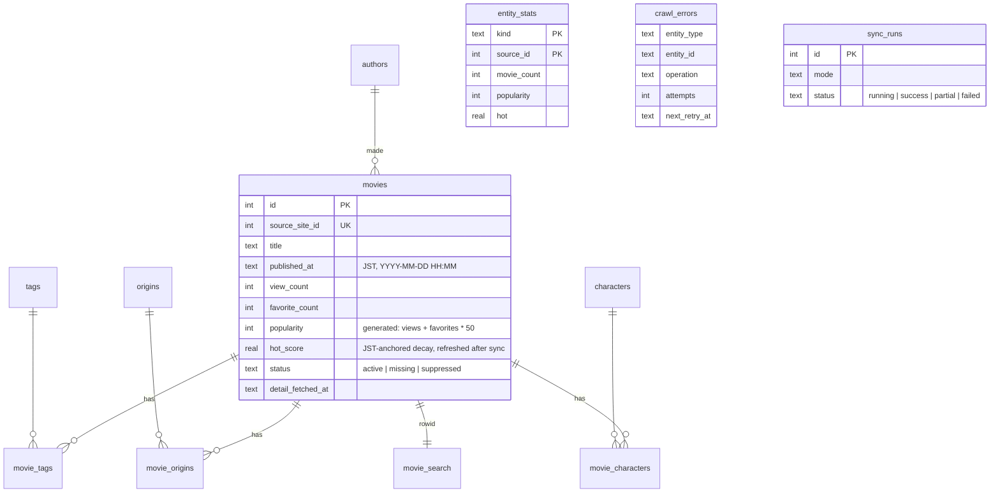

# Architecture

Search Iwara consists of a batch crawler (`search-iwara sync`) and a read-only web server (`search-iwara serve`) sharing one SQLite database in WAL mode. SQLite handles relational tables, full-text search (FTS5), and precomputed ranking tables without external queues, caches, or search daemons.

```mermaid
flowchart LR
    subgraph crawl ["search-iwara sync (systemd timer / cron / container loop)"]
        C[crawler.py<br/>rate limiter, redirect checks, robots.txt] --> P[parsers.py<br/>Lexbor HTML parser, URL allow-list]
        P --> S[services.py<br/>listing scan, bounded detail queue]
        S --> W[storage/crawl_store.py<br/>batched commits, error ledger]
    end
    W -->|WAL| DB[(SQLite Schema v5<br/>movies, relations, FTS5,<br/>entity_stats, app_meta)]
    DB -->|read-only pool| R[storage/search_store.py<br/>storage/ranking_store.py]
    subgraph web ["search-iwara serve (uvicorn)"]
        R --> WEB[web/pages.py, web/api.py, web/ops.py]
        WEB --> T[Jinja2 templates + static assets]
    end
    O3D[(oreno3d.com)] --> C
```

## Module Responsibilities

| Module | Responsibility |
|---|---|
| `config.py` | `Settings` (`pydantic-settings`): validates `SEARCH_IWARA_*` environment variables at startup |
| `models.py` | Dataclasses shared across layers (`MovieDetail`, `MovieCard`, `SearchFilters`, `SearchPage`, `RankingRow`) |
| `crawler.py` | `Oreno3dClient`: HTTP/2 client with RFC 9309 `robots.txt`, 5-hop redirect validation, streaming byte caps, AIMD token bucket, full-jitter backoff, and `Retry-After` |
| `parsers.py` | `selectolax.lexbor` HTML parsers; normalizes text, validates every URL via `utils.safe_url` (`https` + host allow-list), and raises `ParserDriftError` on markup changes |
| `services.py` | `SyncService`: `sync_latest` and `sync_full` pipelines, detail worker pool, run accounting, and `flock` mutual exclusion |
| `storage/migrations.py` | Sequential schema migrations up to Schema v5 tracked via `PRAGMA user_version` |
| `storage/crawl_store.py` | Write path: movie upserts, relation replacement, FTS5 maintenance, suppression tombstones, retry ledger, derived-table refresh, and online backups |
| `storage/search_store.py` | Read path: boolean/range queries, dual FTS5 search, live result-scoped facet counts, detail lookup, weighted related works, entity name resolution, and autocomplete |
| `storage/ranking_store.py` | Searchable, multi-sortable entity directories (`characters`, `authors`, `tags`, `origins`, `categories`) backed by `entity_stats` |
| `web/app.py` | FastAPI lifespan (migrate once, open cgroup-aware `ReadOnlyPool`), middleware wiring, error handlers, and fingerprinted static mounts |
| `web/pages.py`, `web/api.py`, `web/ops.py` | HTML routes, `/api/{kind}` autocomplete JSON, `/healthz`, `/readyz`, `/metrics`, `robots.txt`, and optional sitemaps |
| `web/query.py` | `SearchParams`: strict structural bounds (`422` on oversized input) paired with forgiving value parsing and swapped-range normalization |
| `web/security.py`, `web/metrics.py` | Pure-ASGI middleware for security headers and Prometheus instrumentation |
| `i18n.py`, `locales/*.toml` | Locale catalogs (`zh-Hans`, `ja`, `en`) and `Accept-Language` / cookie / `?lang=` negotiation |
| `cli.py` | Typer CLI (`sync`, `db migrate|backup|refresh|reindex|suppress|unsuppress`, `serve`) and exit codes |

Dependencies point inward: `web` -> `storage` -> `models`, and `services` -> `crawler` / `parsers` / `storage`. Storage code never performs network I/O, and web request handlers never write to SQLite.

## Data Model & Schema v5 Indexing

- **`movie_search` (`FTS5`, `tokenize='trigram'`, `content='', contentless_delete=1`)**: Indexes `title` and aggregated `keywords` (author, character, origin, and tag names) for `status = 'active'` movies. Serves substring matches for tokens of 3 or more characters across Latin and CJK scripts without duplicating raw text in `%_content` shadow tables.
- **`movie_search_short` (`FTS5`, `unicode61`, `prefix='1 2'`, `content='', contentless_delete=1, detail=none`)**: Indexes CJK unigrams and bigrams alongside non-CJK word tokens. One- and two-character Chinese or Japanese queries execute as exact FTS token lookups, while 1–2 letter Latin queries (`mm`, `3d`) match word prefixes (`mm` -> `MMD`). Omitting positional offsets (`detail=none`) cuts this table's disk size by ~79%.
- **Consistency & mega-entity renames**: Marking a movie `missing` or `suppressed` removes its FTS rows immediately. If an upstream entity is renamed, `CrawlStore` updates FTS inline when attached to `<= 500` movies, or sets `app_meta['fts_dirty'] = '1'` so `refresh_derived(full=True)` rebuilds FTS in streamed 5,000-row batches without holding a long write lock.
- **`entity_stats` & `app_meta`**: `entity_stats` stores precomputed counts, views, likes, popularity, and JST trending scores per entity; SQLite triggers maintain `app_meta['active_movies']` so unfiltered totals, sitemaps, and `/metrics` never scan `movies`.
- **Composite indexes**: Sort columns carry covering indexes (`(status, published_at DESC, ...)`, `(status, popularity DESC, ...)`, `(status, hot_score DESC, ...)`, `(status, favorite_count DESC, ...)`), `/authors` uses `idx_movies_author_top(author_id, status, popularity DESC, source_site_id DESC)`, and `tag_all` queries order predicates from rarest to most common tag via `entity_stats`.

See [docs/benchmarks.md](benchmarks.md) and [docs/adr/](adr/) for measured latencies and design trade-offs.

### `crawl_state` Checkpoints

| Key | Purpose |
|---|---|
| `sync_full_target_last_page` | Total listing pages reported by the upstream site at the start of the active full crawl |
| `sync_full_last_completed_page` | Highest listing page completed contiguously without gaps |
| `sync_full_round_started_at` | Timestamp when the current full crawl started at page 1 (used for overlap verification on resume) |
| `sync_latest_last_checked_page` | Last listing page inspected by the most recent `sync latest` run |

## Sync Pipeline

### `sync latest` & `sync full`

`sync latest` scans from page 1 and stops after `--stable-pages` consecutive pages containing no unseen movie IDs (or at `--max-pages` / 3 consecutive listing errors). It then queues newly discovered movies, due retries from `crawl_errors`, and up to `SEARCH_IWARA_DETAIL_REFRESH_LIMIT` recently published works whose details are older than `SEARCH_IWARA_DETAIL_REFRESH_AFTER_HOURS`.

`sync full` scans the catalogue in prefetch batches, advancing `sync_full_last_completed_page` only across contiguous successes. On resume, it steps back `SEARCH_IWARA_RESUME_OVERLAP_PAGES` (default `1`) and walks back up to 50 pages if upstream deletions shifted listings ahead of the checkpoint.

### Detail Workers, Suppression & Network Bounds

A bounded `asyncio.Queue` (`4 * workers`) feeds `SEARCH_IWARA_REQUEST_CONCURRENCY` workers, committing writes in batches of 25:

- **`active`**: parsed detail upserts movie + relations and clears prior `crawl_errors`.
- **`missing`**: upstream `404`/`410` or placeholder page marks `status = 'missing'`, drops FTS postings, and preserves archival metadata on `/movies/{id}`.
- **`suppressed`**: operator takedown via `search-iwara db suppress <id>` sets `status = 'suppressed'`, purges FTS postings, returns `404` on `/movies/{id}`, and prevents future syncs from re-activating the entry.
- **Parser drift**: missing listing grids or 5 structural detail parse failures in one run abort with exit code `2` while draining queued workers cleanly.
- **Network guards**: `Oreno3dClient` shares a global AIMD token bucket (`2.0` req/s default, halved on `429`/`503`), enforces RFC 9309 `robots.txt` on every redirect hop (max 5 hops within the configured `https` origin), and caps response bodies at `2 MiB` (`robots.txt`) and `10 MiB` (HTML).

## Web Tier

- **Read-only pool**: Startup runs `migrate()`, checks cgroup/host memory to scale SQLite `mmap_size` safely (`32 MiB` on `< 1.5 GiB` hosts), and opens one `PRAGMA query_only` connection per worker thread.
- **Dynamic facets & bounded counts**: Search counts cap at `SEARCH_IWARA_MAX_RESULT_WINDOW` (`10,000+`). Filtered searches compute result-scoped facet counts across authors, characters, origins, and tags (`SearchStore.facet_counts`).
- **No-JS entity resolution**: Submitting typed entity names in `q_*` fields resolves against indexed entities (NFKC-normalized) and issues a `303 See Other` redirect to canonical ID parameters.
- **Security & conditional caching**: Responses emit strict `Content-Security-Policy` (`script-src 'self'; style-src 'self'`), `COOP`, `CORP`, `nosniff`, and weak `ETag` headers (`304 Not Modified` on `GET`/`HEAD` cache hits). Static files use `?v=<sha256>` hashes with `Cache-Control: immutable`.
