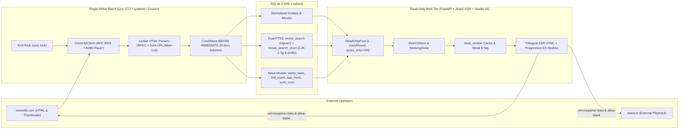

# Comprehensive Critical Audit (`v0.2.2` Baseline `97fb04d`)

**Audit Date**: `2026-11-25`  
**Baseline Commit**: `97fb04d` (`main`)  
**Methodology**: Full source inspection (100% of Python, SQL, Jinja2, CSS, JS, shell, Docker, Nginx, systemd, Prometheus, and CI files), reproducible 200,000-movie SQLite benchmark (`EXPLAIN QUERY PLAN`, cold/warm P50/P95/P99, 16-thread concurrency, peak RSS), OWASP ASVS security review, RFC 9309 compliance review, and an independent zero-context `frontend-reviewer` live browser audit across desktop (`1440×900`, `1024×800`), tablet (`768×1024`), and mobile (`390×844`) viewports in `zh-Hans` / `ja` / `en` and dark / light / No-JS modes.

---

## 1. System Architecture & Product Understanding

### 1.1 Confirmed Facts, Inferences, and Boundaries

- **Confirmed Facts**:
  - Search Iwara is a single-node self-hosted metadata mirror and boolean search workbench for [Oreno3D](https://oreno3d.com/) / [Iwara](https://www.iwara.tv/) 3D & MMD works. It stores **textual metadata and allow-listed URLs only**; it never downloads, transcodes, or hosts media binaries.
  - Module graph is strictly acyclic: `models` / `utils` / `config` / `i18n` ← `parsers` / `crawler` / `storage` ← `services` ← `cli` / `web`.
  - Concurrency model: `web` executes synchronous FastAPI handlers on a bounded worker thread pool (`web_threads = 40`), each thread owning one read-only SQLite connection (`ReadOnlyPool`, `PRAGMA query_only = ON`). `crawler` uses `asyncio` (`httpx.AsyncClient`, default concurrency `4`, rate `2.0 req/s`) writing to a single `CrawlStore` guarded by `fcntl.flock` (`sync.lock`).
  - Baseline automated gates on `97fb04d` pass (`ruff`, `mypy --strict`, `tsc --checkJs`, `shellcheck`, `303` unit/property tests at `95.89%` coverage, `20` slow tests, `52` Playwright E2E tests, `0` `pip-audit` vulnerabilities).
- **Evidence-Backed Inferences**:
  - Target deployment is a low-cost self-hosted Linux VPS (`1–2 vCPU`, `1–2 GiB RAM`, local SSD) or home server; therefore a `2.71 GiB` migration peak RSS on 200k movies represents an operational OOM risk on 1–2 GiB hosts.
  - Upstream `oreno3d.com` emits naive `Asia/Tokyo` (`UTC+9`) timestamps (`YYYY-MM-DD HH:MM`), confirmed by `search_iwara/web/formatting.py:15` (`SOURCE_TZ = ZoneInfo("Asia/Tokyo")`).
- **Unavailable / Out-of-Scope Information**:
  - Live traffic telemetry from third-party deployments and internal upstream server capacity (no unauthorized load testing against external services was performed).

### 1.2 Architecture & Request/Sync Lifecycle

---

## 2. Classified Audit Findings (`P0`–`P3`)

No `P0` crash or data-corruption blocker exists on `97fb04d`. We identified **12 `P1` high-impact defects/design flaws** and **2 `P2` hardening/debt items** (incorporating `P3` polish items).

| ID | Sev | Type | Summary | Primary Locations |
|---|---|---|---|---|
| `AUD-001` | **P1** | Confirmed Defect | FTS5 index consistency drift on `missing`/suppressed movies & upstream entity renames | `storage/crawl_store.py`, `storage/search_index.py`, `storage/sql.py` |
| `AUD-002` | **P1** | Confirmed Defect | 9-hour JST (`UTC+9`) vs UTC skew in `HOT_SCORE_UPDATE`, `HOT_SCORE_UPDATE_RECENT`, and `stale_detail_ids` | `storage/sql.py`, `storage/crawl_store.py` |
| `AUD-003` | **P1** | Confirmed Defect | Missing Unicode NFKC normalization in entity autocomplete & No-JS entity resolution | `storage/search_store.py` |
| `AUD-004` | **P1** | Perf / Scale Defect | SQLite 200k query-plan & memory bottlenecks (`tag_all` `261 ms`, `/authors` `134 ms`, `related_movies` `41 ms`, `2.7 GiB` migration RSS, `193 MB` FTS bloat) | `storage/search_store.py`, `storage/ranking_store.py`, `storage/migrations.py`, `storage/connection.py` |
| `AUD-005` | **P1** | Security / RFC 9309 | Crawler blind redirect following (`follow_redirects=True`) & unbounded response body buffering | `crawler.py` |
| `AUD-006` | **P1** | Confirmed Defect | Web HTTP `304` skips `LANG_COOKIE` & `303` redirects; `/readyz` `500` on missing DB; `405` on `HEAD` ops/API routes | `web/pages.py`, `web/ops.py`, `web/api.py` |
| `AUD-007` | **P1** | UX / Product Defect | Static pseudo-facet workbench, silent context-wiping row links & nested desktop sidebar scrollbar | `templates/_macros.html`, `web/pages.py`, `storage/search_store.py`, `static/style.css` |
| `AUD-008` | **P1** | UX / IA Defect | Rankings directory duplicate desktop nav, missing in-directory search/sort, 660px table gap & `/authors` 20,000px wall | `templates/base.html`, `templates/entity_index.html`, `web/pages.py`, `storage/ranking_store.py`, `static/style.css` |
| `AUD-009` | **P1** | UX / State Defect | Filter sheet stale `
` count badges & combobox forced `instant` scroll jump / `.is-dropup` dead code | `templates/index.html`, `static/app.js`, `static/style.css` |
| `AUD-010` | **P1** | Mobile UX Defect | Mobile hidden home brand icon, cramped search input (`156px` chrome), off-screen "Clear all" & `60fps` → `60f...` truncation | `static/style.css`, `templates/base.html`, `templates/index.html` |
| `AUD-011` | **P1** | UX / Query Defect | `status="missing"` archive detail pages lose all `related_movies`, and related cards omit tags | `storage/search_store.py` |
| `AUD-012` | **P1** | Compliance Gap | No persistent local takedown (`suppressed`) status/CLI or documented rights-holder takedown workflow | `storage/crawl_store.py`, `cli.py`, `SECURITY.md` |
| `AUD-013` | **P2** | UX Hardening | Inverted range handling, unmatched `q_*` chip UX & removal bug, `author_comment` linkification, un-fetched detail badge, `768–1100px` wrap, No-JS `/` kbd | `web/pages.py`, `web/formatting.py`, `templates/movie_detail.html`, `static/app.js`, `static/style.css` |
| `AUD-014` | **P2** | Ops / Sec / Debt | Docker loop 10m startup sleep & `SIGTERM` hang, Nginx `/static/` dropped security headers, webhook URL validation, `COOP`/`CORP`, `9.5 MiB` `design-evidence/` bloat, weak perf/property test oracles | `deploy/**`, `web/security.py`, `manifest.webmanifest`, `README*.md`, `tests/test_performance.py`, `tests/test_properties.py` |

---

### Detailed Findings Specification

#### `AUD-001` · `[P1]` FTS5 Index Consistency Drift on `missing`/Suppressed Movies & Entity Renames
- **Evidence**:
  1. `CrawlStore.mark_movie_missing()` (`crawl_store.py:219-234`) sets `movies.status = 'missing'` without deleting `rowid` from `movie_search` or `movie_search_short`; `SEARCH_DOCUMENT_SELECT` (`sql.py:33-48`) also omits `WHERE m.status = 'active'`.
  2. `CrawlStore._upsert_entity()` (`crawl_store.py:59-75`) updates entity `name` on conflict, while `apply_movie_detail()` only reindexes the single movie being processed—leaving stale entity names in FTS across all previously indexed works of that creator/tag/character/origin.
- **Root Cause**: FTS updates were wired only to single-movie `apply_movie_detail`/`upsert_list_items` rather than all mutations affecting searchable text or active visibility.
- **Impact**: Ghost postings inflate FTS subqueries; renamed creators/tags become unsearchable on older works.
- **Cost / Risk**: Low–Medium / Low.
- **Acceptance Criteria**: `0` non-active rowids exist in `movie_search`/`movie_search_short`; renaming any entity immediately updates FTS hits for all linked active movies; `FTS5 integrity-check` passes.

#### `AUD-002` · `[P1]` 9-Hour JST vs. UTC Skew in `HOT_SCORE_UPDATE`, `HOT_SCORE_UPDATE_RECENT`, and `stale_detail_ids`
- **Evidence**: `movies.published_at` is naive JST (`UTC+9`), whereas `sql.py:21-31` uses UTC `julianday('now')` and `date('now', '-30 days')`, and `crawl_store.py:369` formats UTC `moment`. Every upload in the newest 9 hours gets negative age clamped to `0.0`, destroying `hot_desc` time-decay differentiation among fresh works.
- **Cost / Risk**: Low / Very Low.
- **Acceptance Criteria**: `HOT_SCORE_UPDATE` and `HOT_SCORE_UPDATE_RECENT` evaluate against `datetime('now', '+9 hours')` / `date('now', '+9 hours', '-30 days')`; 1h-old and 8h-old JST works with equal popularity have distinct `hot_score` values.

#### `AUD-003` · `[P1]` Missing NFKC Normalization in Entity Autocomplete & No-JS Entity Resolution
- **Evidence**: `parsers.py` stores NFKC-normalized entity names (`4K`, `MMD`, `ダンス`), but `SearchStore.autocomplete_with_counts()` (`search_store.py:302`) and `resolve_entity_names()` (`search_store.py:333`) only call `.strip()`. Fullwidth `４Ｋ` / `ＭＭＤ` / halfwidth `ﾀﾞﾝｽ` return 0 matches.
- **Cost / Risk**: Very Low / Very Low.
- **Acceptance Criteria**: Fullwidth/halfwidth CJK compatibility forms resolve identically to canonical ASCII/Katakana in both `/api/{kind}` autocomplete and `q_*` resolution.

#### `AUD-004` · `[P1]` SQLite 200k Query-Plan, Tail-Latency, Disk & Migration Memory Bottlenecks
- **Evidence** (`baseline_metrics.json`, 200,000 movies):
  - `search_tag_all_and_not`: **`261.3 ms` P50** (`16`-thread P95 **`2,136.9 ms`**) because `mode == 'all'` materializes every tag's full movie ID list twice instead of driving from `MIN(movie_count)` + PK `EXISTS`.
  - `GET /authors`: **`134.4 ms` P50 / `243.9 ms` P95** because `idx_movies_author_id(author_id)` forces full partition fetch+sort across prolific authors.
  - `detail_related_movies`: **`41.1 ms` P50** because `EXPLAIN QUERY PLAN` runs `SELECT COUNT(*) FROM movies WHERE status = 'active'` 3× and scans all 200k rows of `idx_movies_hot` to join a ~50-row `scored` CTE.
  - `rebuild_short_index()` `.fetchall()` spikes migration RSS to **`2,705.4 MB`**; duplicated FTS `%_content` + `detail=full` on `movie_search_short` consumes **`192.55 MB`** of `327.42 MB` DB; `PRAGMA journal_size_limit` is unset.
- **Cost / Risk**: Medium / Low (verified by Oracle Equivalence Hypothesis tests + 200k benchmark comparison).
- **Acceptance Criteria**: `search_tag_all_and_not` P50 `< 20 ms`; `GET /authors` P50 `< 25 ms`; `detail_related_movies` P50 `< 5 ms`; migrated 200k DB `< 240 MB`; migration peak RSS `< 600 MB`.

#### `AUD-005` · `[P1]` Crawler Blind Redirect Following & Unbounded Response Buffering
- **Evidence**: `Oreno3dClient` (`crawler.py:161, 261`) sets `follow_redirects=True` without re-validating redirect target scheme/host or `robots.txt` rules, and buffers response bodies without a byte limit.
- **Cost / Risk**: Low / Low.
- **Acceptance Criteria**: Redirects `> 5` hops, off-domain redirects, `robots.txt`-disallowed redirect hops, and responses exceeding `2 MiB` (`robots.txt`) / `10 MiB` (HTML) abort deterministically with `CrawlerError`.

#### `AUD-006` · `[P1]` Web HTTP Conditional `304` Ordering, `/readyz` `500`, and `HEAD` `405`
- **Evidence**: `not_modified()` in `web/pages.py:377` runs before `_blank_param_redirect`, before `q_*` `303` resolution, and skips `Set-Cookie: ui_lang=...` when switching back to a cached `?lang=` URL; `/readyz` (`ops.py:35`) fails to catch `StorageError` (`500` instead of `503`); `/robots.txt`, `/favicon.ico`, `/sitemap*.xml`, `/metrics`, and `/api/{kind}` return `405` on `HEAD`.
- **Cost / Risk**: Low / Very Low.
- **Acceptance Criteria**: Conditional `304` never bypasses `303` redirects or `LANG_COOKIE` updates; `/readyz` returns `503` when DB is absent; `HEAD` returns `200` on all read ops/API endpoints.

#### `AUD-007` · `[P1]` Static Pseudo-Facet Workbench, Context-Wiping Row Links & Nested Scrollbar
- **Evidence**: Independent browser review (`screenshots_baseline/01_home_desktop_zh_dark.png`, `24_filter_sheet_stale_badge_and_metrics.png`): left workbench always shows whole-DB Top-6, clicking row text (`solo_href`) wipes active `q`/filters/sort, and `.sidebar`'s `max-block-size` nested scrollbar slices rows in half and hides `Origins` at `1440×900`.
- **Cost / Risk**: Medium / Low.
- **Acceptance Criteria**: Workbench reflects active search/filter result counts (with active facet items pinned), row clicks preserve search context (toggling inclusion), and all 4 dimensions fit cleanly without a nested sidebar scrollbar.

#### `AUD-008` · `[P1]` Rankings Directory Duplicate Nav, Missing Search/Sort, 660px Gap & `/authors` Density
- **Evidence**: `screenshots_baseline/15_rankings_characters_desktop_zh_light.png`, `16_rankings_authors_desktop_ja_dark.png`: identical 5 links rendered twice within 40px on desktop while lacking a `Search` link in `.site-nav`; no in-directory filter or sort switcher; ~660px empty gap on `1440px`; 60 expanded author galleries (>20,000px page height).
- **Cost / Risk**: Medium / Low.
- **Acceptance Criteria**: Desktop top nav has explicit `Search` + 4 core entity links (`Characters`, `Authors`, `Tags`, `Origins`; `/categories` remains a valid backward-compatible route without duplicating nav rows); directory pages provide SSR + progressive keyword filter (`?q=`) and sort switcher (`popularity`, `hot`, `movies`, `favorites`, `views`); `/authors` showcases Top 3 expanded rails on page 1 with zero-JS `
` previews for `#4..#60`.

#### `AUD-009` · `[P1]` Filter Sheet Stale Group Badges & Combobox Instant-Scroll Jump
- **Evidence**: `screenshots_baseline/24_filter_sheet_stale_badge_and_metrics.png`, `11b_mobile_filter_sheet_combobox_open.png`: `
` badges stay frozen at SSR count (`1` when 3 chips exist), `Date & metrics` has no badge, and `positionPopup()` removes `.is-dropup` and forces `instant` scroll jumps.
- **Cost / Risk**: Low / Low.
- **Acceptance Criteria**: All 5 filter-sheet `
` badges update live on chip/range edits; combobox uses `.is-dropup` when bottom space is tight without jarring scroll jumps.

#### `AUD-010` · `[P1]` Mobile Header Crowding, Hidden Brand Link, Off-Screen "Clear All" & `60f...` Tag Truncation
- **Evidence**: `screenshots_baseline/23_mobile_filtered_nonempty_zh_dark.png`: mobile `.brand` is `display: none`; `156.4px` of `316px` search bar is consumed by inner controls; "Clear all filters" sits at `x = 815px` off-screen; `60fps` truncates to `60f...`.
- **Cost / Risk**: Low / Low.
- **Acceptance Criteria**: Mobile header keeps compact `.brand` home icon, omits redundant `.search__scope` pill, keeps `<input>` font-size `>= 16px`, surfaces a visible "Clear all" control without horizontal scrolling, and renders `60fps` without truncation.

#### `AUD-011` · `[P1]` `status="missing"` Detail Page Loses Related Videos & Related Cards Drop Tags
- **Evidence**: `screenshots_baseline/13a_detail_missing_with_meta_en_light.png`, `search_store.py:275, 294`.
- **Cost / Risk**: Very Low / Very Low.
- **Acceptance Criteria**: `status="missing"` detail pages display watchable `active` related works, and all related movie cards include their tags (`with_tags=True`).

#### `AUD-012` · `[P1]` Missing Persistent Local Takedown (`suppressed`) Workflow & Policy
- **Evidence**: `SECURITY.md` lacks metadata takedown instructions, and crawler sync overwrites manual `missing`/deleted rows.
- **Cost / Risk**: Low / Very Low.
- **Acceptance Criteria**: `search-iwara db suppress <id>...` / `unsuppress <id>...` permanently suppresses/restores items across search, rankings, sitemaps, detail pages, FTS5, and future `sync` runs; `SECURITY.md` documents the takedown procedure.

#### `AUD-013` · `[P2]` Frontend Input Validation, Detail Linkification & Intermediate Breakpoint Polish
- **Acceptance Criteria**: Inverted numeric/date ranges auto-swap via `303`; unmatched `q_*` chips show explicit unmatched status with isolated per-param `remove_href`; `author_comment` safely linkifies `https://` URLs with `overflow-wrap: break-word`; un-fetched detail rows show accurate pending/source-only status; `768px–1100px` toolbar stays balanced; `.no-js` hides `/` badge; non-500 error pages retain footer dataset stats.

#### `AUD-014` · `[P2]` Ops, Security Headers, Repository Hygiene & Test Suite Oracles
- **Acceptance Criteria**: `sync-loop.sh` syncs immediately on boot and both Docker loops exit cleanly on `SIGTERM`; Nginx `/static/` preserves security headers and scopes `immutable` to `?v=`; `alert_webhook` rejects `file://`/`ftp://`; `COOP` & `CORP` headers are set; `9.5 MiB` `design-evidence/` and root scratch `DESIGN_*.md` files are removed; `manifest.webmanifest` & `README*.md` match current architecture; Hypothesis Search Oracle Equivalence tests and P50/P95 performance assertions pass.
